# Trunk-based development, feature flags and canary deploys

A hands-on guide built around one small demo, **Flagship**: a one-button Rails store on Cloud Run, 12 bots that visit it as different kinds of users and check the button's color, and a dashboard that shows what each bot saw.

The one idea to take away:

> **Deploying code and releasing a feature are two different steps.**
> A canary deploy decides which *requests* run new code. A feature flag decides which *users* see a new feature. Trunk-based development works because the second step lets you merge unfinished work safely.

Every command in this guide is a `make` target, and every target prints the real `gcloud` command before it runs it. You can follow along by reading, or run each step yourself and watch the dashboard change.

## Contents

1. [Three ideas, one demo](#1-three-ideas-one-demo)
2. [Trunk-based development](#2-trunk-based-development)
3. [Feature flags the Rails way, without a gem](#3-feature-flags-the-rails-way-without-a-gem)
4. [Canary deploys on Cloud Run](#4-canary-deploys-on-cloud-run)
5. [Deploy is not release](#5-deploy-is-not-release)
6. [The demo: store, bots and dashboard](#6-the-demo-store-bots-and-dashboard)
7. [Rollout playbook](#7-rollout-playbook)
8. [When it breaks: rollback or kill switch](#8-when-it-breaks-rollback-or-kill-switch)
9. [Cleaning up](#9-cleaning-up)
10. [Costs and guardrails](#costs-and-guardrails)
11. [Reference: make targets](#reference-make-targets)

---

## 1. Three ideas, one demo

**Trunk-based development.** Everyone integrates into one branch, `main` (the trunk), in small pieces, at least daily. Branches live for hours, not weeks. `main` is always in a state you could ship.

**Feature flags.** A feature flag is an `if` around new behavior whose answer comes from configuration instead of code: "show the orange button to this user?" Code can be merged and deployed while the flag is off, then *released* later, to some users first, without another deploy of new code.

**Canary deploys.** A new version of the app first gets a small share of real traffic, say 10% of requests, while the old version handles the rest. If the new version misbehaves, only that 10% is affected and you send everything back to the old one. Named after the canaries miners carried to detect gas early.

How they fit together in this demo:

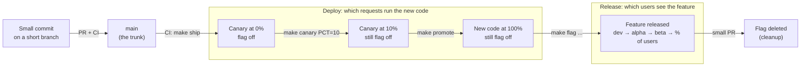

---

## 2. Trunk-based development

### The rules

- **One long-lived branch: `main`.** No `develop`, no long-running release branches.
- **Short-lived branches, small pull requests.** A branch should merge within a day. If a feature takes two weeks, it goes in as many small merges, each one hidden behind a flag until the whole thing is ready.
- **CI on every push.** Tests run on every pull request and every merge, so a broken `main` is noticed in minutes.
- **`main` is always shippable.** Here every merge to `main` is actually deployed, as a canary at 0% traffic.
- **Unfinished work ships dark.** It's merged and deployed with its flag off. Nobody sees it until the flag says so.

The alternative is long-lived feature branches that drift from `main` for weeks and then have to be merged all at once ("merge hell"). Trunk-based development trades that for many small, boring merges.

### This repository's history

The demo follows the rules. The orange button was built on a short branch and merged while switched off:

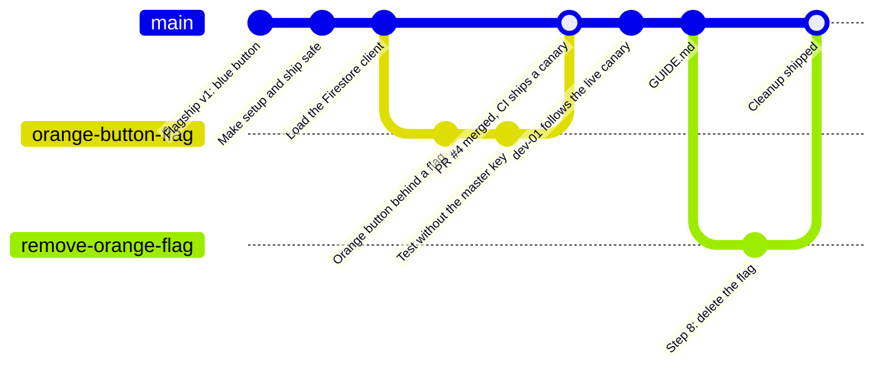

The small commits straight to `main` are real fix-forwards, each found by running the demo for real:

- **Load the Firestore client.** The first bot run on Cloud Run failed because the Firestore library wasn't loaded. The tests use a local file instead of Firestore, so they hadn't noticed. The fix was one line plus a test.
- **Test without the master key** (on the PR branch). The PR's tests passed on a laptop and failed in CI, which has no master key. See gotcha 6 below.
- **dev-01 follows the live canary.** After a promote, `dev-01` kept visiting the old canary revision. See [three things that surprise people](#three-things-that-surprise-people).

None of them was reverted. Each was a small commit, tested, and shipped through the same canary steps as any other change.

The last branch, the cleanup in step 8, is yours to make when you finish the walkthrough.

### CI in this repo

[`.github/workflows/ci.yml`](.github/workflows/ci.yml) runs four jobs:

| Job | When | What |
| --- | --- | --- |
| `scan_ruby` | every PR and push | Brakeman (security scan), bundler-audit (known-vulnerable gems) |
| `lint` | every PR and push | RuboCop |
| `test` | every PR and push | the test suite, including each flag on and off |
| `deploy` | push to `main`, after the three above pass | `make ship`: build the commit and deploy it at 0% traffic |

Changes that only touch Markdown or `docs/` skip CI: there's nothing to test or deploy.

The deploy job has no stored password. GitHub proves to Google which repository and branch it's running for (OpenID Connect), and Google only accepts that proof from this repo's `main` branch (Workload Identity Federation). A pull request from a fork can run tests, but it can't deploy.

Promoting a canary is deliberately *not* automatic: you run `make canary` and `make promote` yourself, so you can watch each step.

---

## 3. Feature flags the Rails way, without a gem

The flag code follows the article [Rails Feature Flags Without a Gem](https://codewithrails.com/blog/rails-feature-flags-credentials/). It needs no database and no flag service. Flags are plain configuration values.

### Where a flag's value comes from

Rails 8.2 adds `Rails.app.creds`: one place to read configuration that checks environment variables first, then the encrypted credentials file. The article puts one more layer in front, for overrides that last a single request. The first answer found wins:

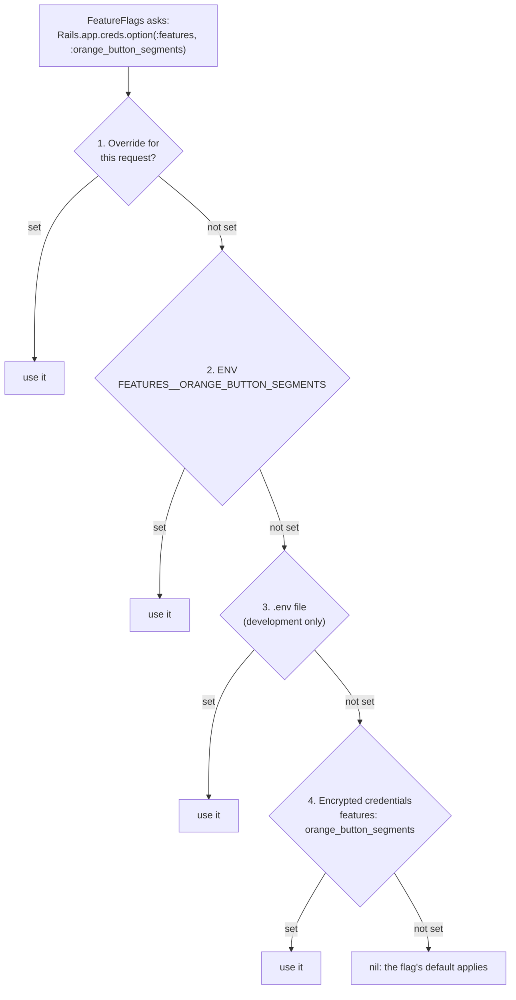

Each layer has its job here:

| Layer | Who sets it | Used for |
| --- | --- | --- |
| Request override | code, `FeatureFlags.with(:orange_button, true) { ... }` | tests, admin tools |
| ENV | `make flag` sets Cloud Run env vars | **releasing**: dev, then alpha, then 25%... |
| `.env` | you, on your laptop (git-ignored) | trying a flag locally |
| Credentials | a pull request, `bin/rails credentials:edit` | **the default**, reviewed like code |

The chain is set up in [`config/initializers/credentials.rb`](config/initializers/credentials.rb):

```ruby
Rails.application.config.to_prepare do
  Rails.app.creds = ActiveSupport::CombinedConfiguration.new(
    FeatureOverrideConfiguration.new,                    # 1
    Rails.app.envs,                                      # 2
    *([ Rails.app.dotenvs ] if Rails.env.development?),  # 3
    Rails.app.credentials                                # 4
  )
end
```

Layers 2–4 are exactly Rails 8.2's default `Rails.app.creds`. The article's version leaves out `.env`; this one keeps it so the default behavior isn't lost.

The default lives in the encrypted credentials:

```yaml
# bin/rails credentials:edit
features:
  orange_button: false
```

Environment variable names map to nested keys with double underscores: `FEATURES__ORANGE_BUTTON_SEGMENTS` is `features → orange_button_segments`.

### Who gets the feature

[`FeatureFlags.enabled_for?(flag, user)`](app/models/concerns/feature_flags.rb) checks four rules in order and stops at the first one that answers:

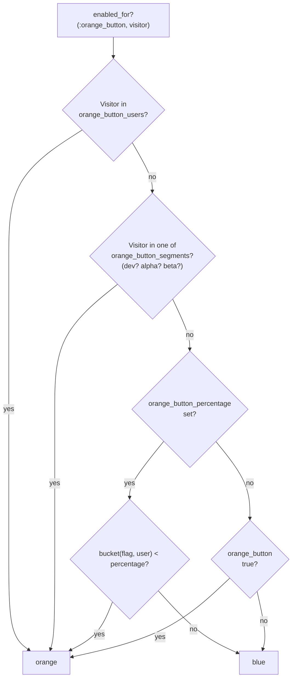

- **Allowlist:** specific user IDs, for example `USERS=user-03`.
- **Segments:** names of methods on the user. `SEGMENTS=dev,alpha` calls `visitor.dev?` and `visitor.alpha?`.
- **Percentage:** every user gets a bucket from 0 to 99, an MD5 hash of the flag name plus the user ID. Users in buckets below the percentage get the feature. The hash doesn't change, so **the same users stay in on every visit**, and raising 25% to 50% only adds users.
- **On/off switch:** `orange_button: true/false`. Note that once a percentage is set, this rule is never reached. "Everyone" is `PERCENT=100`.

In the store it's one line ([`app/controllers/store_controller.rb`](app/controllers/store_controller.rb)):

```ruby
@color = FeatureFlags.enabled_for?(:orange_button, @visitor) ? "orange" : "blue"
```

### Rails 8.2 isn't out yet: the backport

`Rails.app.creds` exists on Rails' main branch but not in any release yet; the latest is 8.1.4. This repo runs 8.1.4 and carries a copy of the 8.2 code in [`lib/backport/`](lib/backport/):

- `CombinedConfiguration`, `EnvConfiguration` and `DotEnvConfiguration`, copied verbatim from Rails main.
- The few methods 8.2 adds to classes 8.1 already has (`credentials.option`, `Rails.app.creds`), also copied verbatim.

[`config/application.rb`](config/application.rb) loads the copy only if Rails doesn't already have `creds`. So the app code calls exactly the API Rails 8.2 will ship, and upgrading means deleting `lib/backport/`. A test fails on Rails 8.2 to remind you.

What could break before 8.2 ships:

- **Rails could still change the API.** It has been stable since February 2026, but nothing is final until it's released.
- **You might forget to delete the copy after upgrading.** The guard in `config/application.rb` stops it from loading, and `test/lib/backport_test.rb` fails to remind you.

### Gotchas found while building this

These are things the article doesn't mention. Each one turned up while writing or testing this repo.

1. **ENV values are always strings.** `FEATURES__ORANGE_BUTTON_SEGMENTS=dev,alpha` arrives as the string `"dev,alpha"`, and the article's `segments(flag).any?` would crash on it. [`feature_flags.rb`](app/models/concerns/feature_flags.rb) splits strings on commas (marked "Changed").
2. **A percentage hides the on/off switch.** See above. "Release to everyone" is `PERCENT=100`.
3. **`FeatureFlags.with` doesn't reach inside a request in Rails 8.1 integration tests.** The article wraps `get checkout_path` in `FeatureFlags.with(...)`. But each request runs in its own execution context with fresh `Current` attributes, so an override set outside the request is gone by the time the controller runs. `with` works fine around plain Ruby code ([`test/models/feature_flags_test.rb`](test/models/feature_flags_test.rb)). Request tests set the flag through ENV instead ([`test/controllers/store_controller_test.rb`](test/controllers/store_controller_test.rb)), and there's a test that pins down this behavior.
4. **`Rails.app.envs` reads ENV once, at boot.** On Cloud Run that's fine: changing an env var starts a new revision with fresh processes. In tests, call `Rails.app.envs.reload` after changing ENV.
5. **gcloud splits env vars on commas.** `--update-env-vars=A=dev,alpha` would set `A=dev` and a variable named `alpha`. The Makefile passes `--update-env-vars="^|^A=dev,alpha"`: the leading `^|^` tells gcloud to split on `|` instead.
6. **CI can't read your credentials, and shouldn't.** In a public repo the master key never goes to GitHub, so in CI the encrypted credentials read as empty and a flag's default comes from `default: false` in the code instead. That's why `enabled?` needs that default. The first PR's tests passed on a laptop and failed in CI for exactly this reason, so tests that need encrypted values make a throwaway file and key of their own ([`test/lib/backport_test.rb`](test/lib/backport_test.rb)).

### Testing both states

Every flag needs tests with it on and with it off: you're shipping both code paths. Model-level tests use `FeatureFlags.with`; request tests use ENV.

```ruby
test "the flag turns the button orange for its segments only" do
  with_env("FEATURES__ORANGE_BUTTON_SEGMENTS" => "beta") do
    Rails.app.envs.reload
    get root_path, headers: { "X-Demo-User" => "beta-02" }
    assert_select "#buy[data-color=orange]"
    get root_path, headers: { "X-Demo-User" => "user-04" }
    assert_select "#buy[data-color=blue]"
  end
end
```

---

## 4. Canary deploys on Cloud Run

### Revisions, traffic and tags

- **A revision** is a frozen version of the service: one image plus its settings (env vars, memory...). Every deploy, *and every settings change*, creates a new revision. Old revisions stay around, which is what makes rollbacks instant. Names look like `flagship-00004-kzn`. The number is neither unique nor in order (this demo got two `00004`s, and a `00006` after a `00009`), so the dashboard shows `rev 4-kzn`.
- **Traffic** says what share of requests each revision gets: `90% → rev 4, 10% → rev 5`. Cloud Run's front end decides per request.
- **A tag** gives one revision its own extra URL, such as `https://canary---flagship-….run.app`. Requests to that URL always reach that revision, whatever the traffic split is.

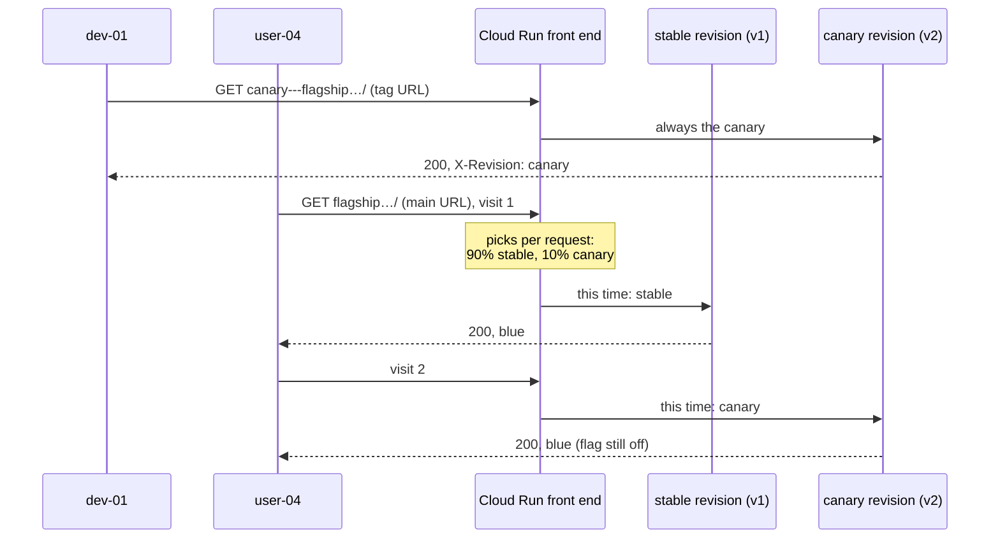

### Do I need a load balancer?

No. Every Cloud Run service comes with Google's front end built in: an HTTPS address with a managed certificate, spreading requests across instances, scaling down to zero, and the traffic split between revisions. A separate load balancer (about $18 a month even when idle) is for things this demo doesn't need: your own domain with a CDN or a web firewall, several services under one domain, or failover across regions.

### The commands behind the make targets

| Make target | gcloud underneath | Effect |
| --- | --- | --- |
| `make ship` | `gcloud run deploy flagship --image=… --no-traffic --tag=canary` | new revision at 0%, reachable through the canary URL |
| | `gcloud run services update-traffic flagship --update-tags=stable=REV` | the revision serving now is tagged `stable`, the rollback target |
| `make canary PCT=10` | `gcloud run services update-traffic flagship --to-tags=canary=10` | 10% of requests to the canary, 90% stay on stable |
| `make promote` | `gcloud run services update-traffic flagship --to-latest --remove-tags=canary` | 100% to the newest revision, traffic follows the latest again, and the canary tag comes off |
| `make rollback` | `gcloud run services update-traffic flagship --to-tags=stable=100` | 100% back to stable, in seconds |

### Three things that surprise people

**A tag sticks to its revision.** The first live run of this demo hit this one. After a promote, the `canary` tag was still on that revision. The next flag change created a newer revision, but `dev-01` kept visiting the old one through the tag, so it never saw the flag turn on. So `make promote` removes the canary tag, and the bots only use a canary URL whose revision is the newest one and isn't already the main one.

**A canary splits requests, not users.** At 10%, the same user can get v1, then v2, then v1. With a feature flag, a user's answer never changes between visits. If flickering matters for your app, Cloud Run has session affinity (best effort), or you can release the visible change with a flag, which is what this demo does.

**A settings change is a deploy too.** `make flag` changes an env var, and that creates a new revision. While traffic is pinned to specific revisions (a canary waiting at 0%, or right after a rollback), a new revision would get 0% and the flag change would silently do nothing. So `make flag` refuses until traffic follows the latest revision again (`make promote`, or ship a fix).

---

## 5. Deploy is not release

| | Deploy (canary) | Release (flag) |
| --- | --- | --- |
| What changes | which **code** runs | which **behavior** users see |
| Split by | request (random each time) | user (the same answer every visit) |
| Who you target | a percentage of requests | named users, groups, or a percentage of users |
| Command | `make ship`, `make canary`, `make promote` | `make flag`, `make flag-off` |
| Takes | a build (minutes), then seconds | seconds, no build |
| Undo | `make rollback`: back to old code | `make flag-off`: old behavior, new code stays |
| Catches | crashes, slowness, memory: "does it run?" | "do users want it, and does it work for them?" |

You need both. A canary tells you the new code runs. A flag lets you decide who sees the new feature, and when.

---

## 6. The demo: store, bots and dashboard

### Architecture

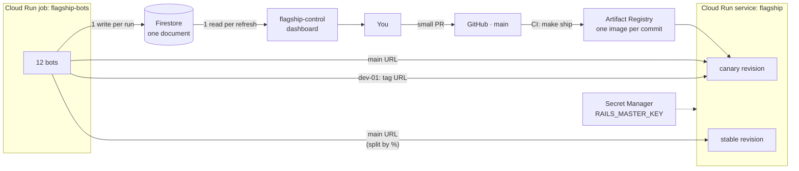

One image runs as all three pieces:

| Piece | Cloud Run resource | How it starts |
| --- | --- | --- |
| Store | service `flagship` | `bin/rails server` |
| Dashboard | service `flagship-control` | `bin/rails server` with `APP_ROLE=control` |
| Bots | job `flagship-bots` | `bin/rails runner BotSquad.run` |

The dashboard is its own service and never gets canaries, so a broken store revision can't take down the thing you're watching it with.

### The bot squad

| Cohort | Bots | Plays | Gets the feature | Visits |
| --- | --- | --- | --- | --- |
| dev | `dev-01` | your teammate | 1st, segment `dev` | the canary's tag URL when there is one, otherwise the main URL |
| alpha | `alpha-01`, `alpha-02` | staff who try things early | 2nd, segment `alpha` | main URL |
| beta | `beta-01` … `beta-03` | customers who opted in | 3rd, segment `beta` | main URL |
| user | `user-01` … `user-06` | everyone else | last, by percentage | main URL |

A bot is a few lines of Ruby ([`app/bots/bot.rb`](app/bots/bot.rb)). It sends `GET /` with `X-Demo-User: beta-02`, the way a browser would send a session cookie for a signed-in user, and reads two things from the response: the button's `data-color` and the `X-Revision` header.

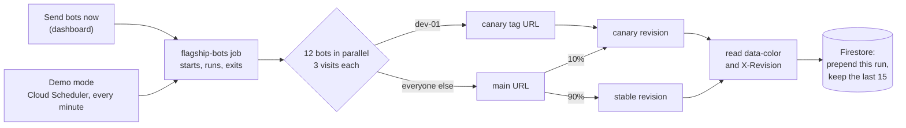

Each bot visits **3 times per run** so the canary is visible: at 10%, about 1 visit in 10 lands on the canary, and you can watch a single bot bounce between revisions.

The percentage buckets are real MD5 hashes, so these are the users who get the orange button at each percentage:

| User | Bucket | 25% | 50% | 100% |
| --- | --- | --- | --- | --- |
| user-01 | 82 | | | ✓ |
| user-02 | 44 | | ✓ | ✓ |
| user-03 | 35 | | ✓ | ✓ |
| user-04 | 15 | ✓ | ✓ | ✓ |
| user-05 | 57 | | | ✓ |
| user-06 | 25 | | ✓ | ✓ |

At 25%, one of the six users is in: chance, not a bug. With six users the shares come out lumpy; with thousands they'd come out close to the percentage.

### The dashboard

Open it with `make urls` (user `flagship`, password from `make password`). This is the live dashboard during step 2, the canary at 10%:

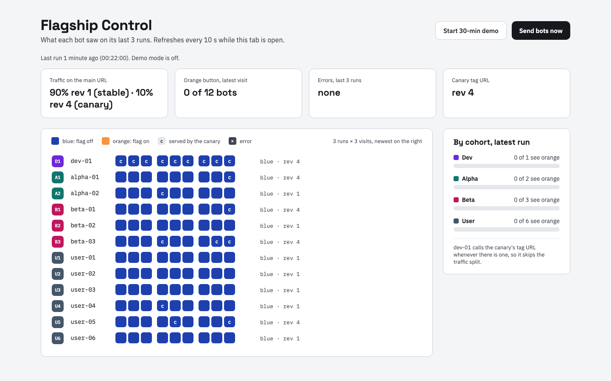

- **The grid:** one row per bot, one square per visit, the last 3 runs from left to right. Blue or orange is the button the bot saw. A **c** means the visit was answered by a revision other than the one with most of the traffic: the canary. **×** means an error. Above, `dev-01` is on the canary for every visit (it uses the tag URL), and a few other bots land on it now and then.
- **Traffic on the main URL:** the split Cloud Run reported when the run started, for example `90% rev 1-64c (stable) · 10% rev 4-wum (canary)`.
- **By cohort:** how many bots in each group saw orange on their latest visit.

It refreshes every 10 seconds while the tab is visible, and each refresh is one Firestore read.

### Why Firestore

Firestore is a NoSQL document database: no tables, no SQL, just documents (JSON-like maps) in collections. There's no server to run, you pay per read and write, and there's a daily free tier. The board is one document, `flagship/board`, holding the last 15 runs. A SQL database (Cloud SQL) would cost around ¥1,500 a month even idle, and SQLite won't work because Cloud Run's disk is wiped whenever an instance stops.

You can look at the document in the Google Cloud console under **Firestore → Data**.

---

## 7. Rollout playbook

Run these in order, and send the bots after each step (`make bots`, the dashboard's **Send bots now**, or `make demo` to have them run every minute for 30 minutes).

| Step | Command | What changes | What the bots see |
| --- | --- | --- | --- |
| 0 · Baseline | `make launch` | v1, without any flag code, serves 100% | all blue |
| 1 · Merge, dark | merge the PR → CI runs `make ship` | v2 deployed at 0%, with the canary tag URL; flag off | all blue; dev-01's visits come from v2 (**c**) |
| 2 · Canary 10% | `make canary PCT=10` | 1 in 10 requests on the main URL run v2 | **all still blue**; about 1 visit in 10 marked **c** |
| 3 · Promote | `make promote` | v2 takes 100%; v1 kept at 0% for rollback | all blue, no **c** |
| 4 · Dev | `make flag FLAG=orange_button SEGMENTS=dev` | env var → new revision, same image | dev-01 orange |
| 5 · Alpha + beta | `make flag FLAG=orange_button SEGMENTS=dev,alpha,beta` | same, more groups | dev, alpha, beta orange |
| 6 · 25% of users | `make flag FLAG=orange_button PERCENT=25` | users with bucket < 25 | + user-04 orange |
| 7 · Everyone | `make flag FLAG=orange_button PERCENT=100` | all buckets | all orange |
| 8 · Clean up | small PR deleting the flag → merge → steps 1–3 | the flag and the blue path are gone from the code | all orange |

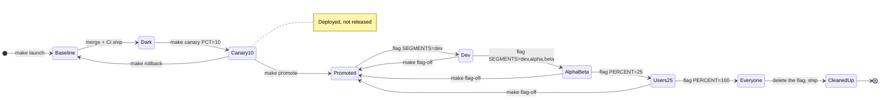

### Step by step

**Step 0 · Baseline.** `make launch` builds the first image and deploys it straight to 100%, along with the dashboard and the bots job. This is v1: a store with a blue button and no flag code at all. It's the "before" picture.

**Step 1 · Merge, dark.** On a short branch, you add the orange button behind `FeatureFlags.enabled_for?(:orange_button, …)`, with the default `orange_button: false` in credentials. The PR runs the tests (flag on and off), you merge, and CI runs `make ship`: v2 is deployed **with 0% of traffic**. Cloud Run gives it its own tag URL, and only `dev-01` uses it. That's a check that v2 starts up and answers in the real environment before any user reaches it. Everyone still gets v1.

**Step 2 · Canary 10%. Deployed, not released.** `make canary PCT=10` sends about 1 in 10 requests on the main URL to v2. This is the step that looks contradictory: 10% of requests now run v2, so why is everything still blue? Because v2 contains the orange-button code, but before it draws the button it asks the flag, *is this on for this visitor?* The flag is off for everyone, so v2 draws blue too. **10% of requests run the new code, and 0% of users see the new feature.**

What you're testing at this step is v2 itself: does it crash, is it slower, does it use more memory. In a real app, v2 would also carry bug fixes and other changes, and those *are* live for that 10%. If v2 breaks, only 10% of requests are affected, and `make rollback` undoes it in seconds. Think of a shop installing new shelves (deploy) with the new product still under a sheet (flag off). Pulling off the sheet (release) is a separate decision.

**Step 3 · Promote.** `make promote` gives v2 all traffic and takes the canary tag off. v1 is still deployed with no traffic and its `stable` tag, so a rollback is still one command away.

**Step 4 · Release to dev.** `make flag FLAG=orange_button SEGMENTS=dev` sets `FEATURES__ORANGE_BUTTON_SEGMENTS=dev` on Cloud Run. Changing an env var creates a new revision from the same image: no build, live in seconds. Only `dev-01` matches the `dev` segment, so only `dev-01` sees orange. This is your team using the feature in production before anyone else.

**Step 5 · Alpha and beta.** The same command with more groups: staff, then customers who opted in. Each group is a chance to find problems while few people would notice them.

**Step 6 · 25% of users.** `PERCENT=25` releases to users whose bucket is under 25. Here that's only `user-04` (bucket 15). Run the bots a few times: `user-04` is orange on every visit, and the other users are blue on every visit. Compare that with step 2, where one bot could bounce between revisions.

**Step 7 · Everyone.** `PERCENT=100`. Every bot sees orange.

**Step 8 · Clean up.** The flag has done its job. Leaving it in means two code paths to maintain forever. On a short branch, delete the `if`, the blue branch of the view, the flag's tests and the `orange_button` entry in credentials, then merge and run steps 1–3 for that commit like any other change. Once the code no longer reads them, the `FEATURES__ORANGE_BUTTON*` variables on Cloud Run do nothing, but tidy up so `make status` stays honest:

```sh
gcloud run services update flagship --region=asia-northeast1 \
  --remove-env-vars=FEATURES__ORANGE_BUTTON,FEATURES__ORANGE_BUTTON_SEGMENTS,FEATURES__ORANGE_BUTTON_PERCENTAGE,FEATURES__ORANGE_BUTTON_USERS
```

---

## 8. When it breaks: rollback or kill switch

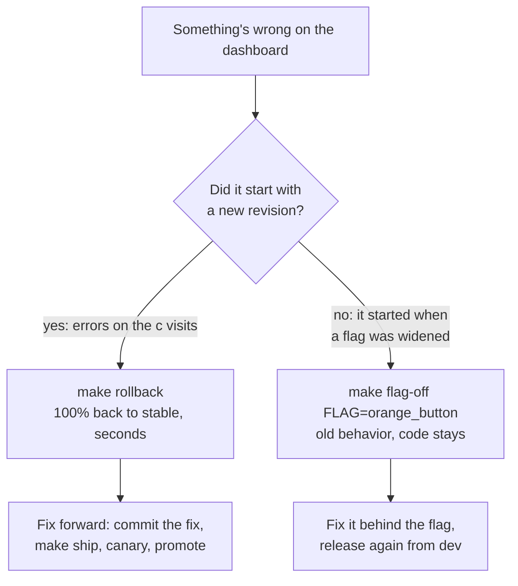

- **Rollback** is for broken *code*. It moves traffic back to the revision tagged `stable`. Nothing is rebuilt, so it takes seconds.
- **The kill switch** is for a broken *feature* in code that is otherwise fine. `make flag-off` sets the flag to false and removes its targeting, so everyone gets the old behavior and the rest of the release stays.

### Drill: a canary that fails

```sh
make ship-broken     # today's image again, with BREAK_STORE=1: every request to it fails
make canary PCT=10   # 1 request in 10 now fails
make bots            # the dashboard shows × on dev-01 and on a few other visits
make rollback        # 100% back to stable
make bots            # errors gone
make ship            # fix forward: redeploys the current commit without BREAK_STORE
make canary PCT=10 && make promote
```

This is the dashboard from a real run of the drill, at 10%:

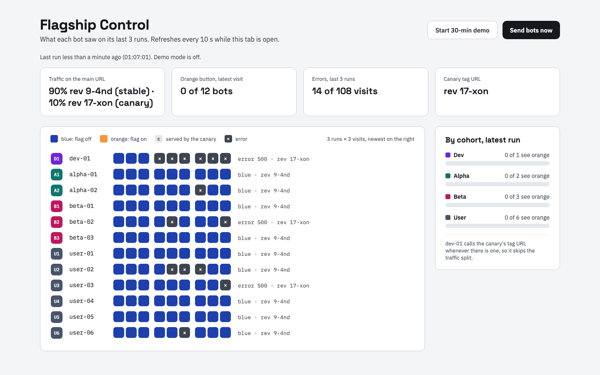

`dev-01` fails on every visit, because it goes straight to the canary. Everyone else fails about 1 time in 10, which is the canary's share. After `make rollback`, users are back on stable right away, but `dev-01` keeps failing until the fix ships: the broken revision still has the canary tag, and dev keeps checking it. That's the point of a dev cohort.

`BREAK_STORE=1` stands in for a bad commit, so you don't have to break `main` to practice. A real bad commit goes the same way, except "fix forward" means merging the fix.

After a rollback, traffic is pinned to the stable revision, so `make flag` refuses to run (see [three things that surprise people](#three-things-that-surprise-people)). Shipping and promoting the fix puts traffic back on "follow the latest".

---

## 9. Cleaning up

- **The flag:** step 8 above.
- **Demo mode:** it switches itself off after 30 minutes. `make bots-off` stops it sooner.
- **Everything on Google Cloud:** `make teardown` deletes the project. Google keeps a deleted project recoverable for 30 days, but it stops all services and billing right away.

---

## Costs and guardrails

| Piece | Free tier | This demo | Expected |
| --- | --- | --- | --- |
| Cloud Run (store, dashboard, bots) | monthly free tier per billing account | scales to zero; a bot run is about 20 s of one CPU | ¥0 |
| Cloud Build | free build minutes each month | ~5 minutes per new commit | ¥0 |
| Firestore | 50k reads and 20k writes a day | 1 write per bot run, 1 read per dashboard refresh | ¥0 |
| Artifact Registry | 0.5 GB | keeps the 3 newest images, ~1 GB | ≈ ¥10 a month |
| Cloud Scheduler | 3 jobs per billing account | 1 job, paused unless a demo is on | ¥0 |
| Secret Manager | 6 secret versions | 2 | ¥0 |

**Estimate: ¥0–100 a month while you experiment.** It's an estimate, not a quote. The Cloud Run free tier is shared with any other projects on the same billing account.

Guardrails:

- **Its own project.** `make teardown` removes everything.
- **Budget alerts:** ¥1,000 total and ¥100 of real money. They email you; they don't stop anything.
- **Scale to zero:** every service has `--min-instances=0`; the store and dashboard are capped at 2 and 1 instances.
- **Bots run only when asked,** and demo mode switches itself off after 30 minutes.
- **Plain HTTP bots:** no headless browser, so 512 MiB instead of 2 GiB.
- **Left out on purpose:** load balancer, Cloud SQL, Memorystore, always-on instances.
- **Public repo, safely:** `config/master.key` is git-ignored and stored in Secret Manager; only this repo's `main` branch can deploy; the dashboard asks for a password because its buttons start paid work.

---

## Reference: make targets

| Target | Does |
| --- | --- |
| `make setup BILLING_ACCOUNT=… GITHUB_REPO=owner/name` | once: project, budgets, APIs, Firestore, Artifact Registry, service accounts, secrets, keyless CI |
| `make launch` | step 0: build, deploy the store at 100%, the dashboard, the bots job, the paused demo schedule |
| `make tools` | redeploy the dashboard and the bots job from the current commit |
| `make ship` | step 1: deploy the current commit at 0% with the canary tag (CI runs this on each merge) |
| `make canary PCT=10` | step 2: that share of requests to the canary |
| `make promote` | step 3: the canary takes 100% |
| `make rollback` | 100% back to the stable revision |
| `make ship-broken` | drill: a canary that fails every request |
| `make flag FLAG=… SEGMENTS=… PERCENT=… USERS=…` | steps 4–7: who gets a flag |
| `make flag-off FLAG=…` | kill switch |
| `make bots` | run the bots once and wait |
| `make demo` | bots every minute for 30 minutes |
| `make bots-off` | stop demo mode now |
| `make status` | revisions, traffic, tags, flags |
| `make urls` / `make password` | where things are, and the dashboard password |
| `make teardown` | delete the project |
| `make dev` / `make dev-bots` / `make test` / `make lint` | on your laptop |
