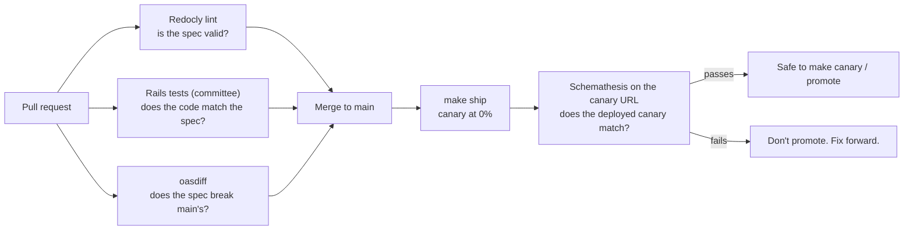

# The API contract (OpenAPI)

The store has a small JSON API next to its page:

| Endpoint | What it does |
| --- | --- |
| `GET /api/v1/flags` | Which flags are on for this visitor, and which rule decided (the page footer, as JSON) |
| `POST /api/v1/purchases` | What the **Buy now** button calls. Nothing is sold or stored; it echoes the order |

[`openapi/openapi.yaml`](../openapi/openapi.yaml) describes both: every parameter, body, status code
and response field. Every revision serves its own copy at `/openapi.yaml`, with a page to read and
try it at `/api/docs`. A canary's tag URL shows the canary's API, before anyone else sees it.

## Why a spec, and why it matters more with canaries

During a canary, two revisions answer the same URL at the same time. A browser can load the page
from the old revision, then send its purchase to the new one. A rollback sends everyone back to the
old revision. So **every API change must work for clients of the old version too**. It's the same
rule as database migrations: expand first, contract later.

A spec makes that rule checkable. Instead of hoping nobody renamed a field, three checks compare
the code and the spec, at three moments:



| Check | Where | Tool | Catches |
| --- | --- | --- | --- |
| The spec is valid and tidy | CI, every push | [Redocly CLI](https://redocly.com/docs/cli/) (`make openapi`) | Typos, missing descriptions, broken `$ref`s |
| The code matches the spec | CI, `bin/rails test` | [committee-rails](https://github.com/willnet/committee-rails) | A response with a missing field or a wrong type, an undocumented status code |
| The spec doesn't break the old one | CI, pull requests only | [oasdiff](https://github.com/oasdiff/oasdiff) | A removed field, a new required parameter, a new enum value in a response |
| The deployed canary matches the spec | CI, after `make ship` | [Schemathesis](https://schemathesis.readthedocs.io/) (`make contract`) | Anything the hand-written tests didn't think of |

### The Rails tests

API tests include `OpenApiContract` (from `test/test_helper.rb`) and end with
`assert_schema_conform(201)`. That one line checks the request against the spec, then the response:
status, headers, and every field of the body.

```ruby
post api_v1_purchases_path, params: { quantity: 2 }, as: :json
assert_schema_conform(201)
```

### Breaking or not?

oasdiff knows the rules. Some examples, for a response the store sends:

| Change | Breaking? | Why |
| --- | --- | --- |
| Add an optional field to a response | No | Old clients ignore fields they don't know |
| Remove a field, or make it optional | **Yes** | An old client may read it |
| Add a value to a response enum (`color: green`) | **Yes** | An old client may not handle it |
| Add an optional request field | No | Old clients don't send it |
| Make a request field required | **Yes** | Old clients don't send it |
| Add a new endpoint | No | Nobody calls it yet |

When you really need a breaking change, add a new version (`/api/v2/...`) next to the old one, move
clients over, and delete v1 in a later PR. Expand, then contract.

### Schemathesis on the canary

[Schemathesis](https://schemathesis.readthedocs.io/) reads the spec and makes up requests: the
documented examples, edge values (0, 10, 11, empty bodies), and wrong ones (strings for numbers,
arrays for objects). Then it checks every answer: no 5xx, a documented status code, the right
content type, headers and body. Settings are in [`schemathesis.toml`](../schemathesis.toml).

It earned its place on day one: it found that `POST /api/v1/purchases` accepted a JSON **array**
(or a string, or `null`) as the body and sold a mug anyway, because Rails hides a non-object body
in `params[:_json]`. The fix and a test are in `PurchasesController`.

The canary has no traffic when Schemathesis runs, so a failure costs nothing: don't promote, fix
forward. The requests are real, though. They show up in Grafana as canary traffic, with a
`schemathesis/…` user agent.

## Try it

```sh
make openapi                            # lint the spec
make dev                                # in another terminal
make contract URL=http://localhost:3000 # Schemathesis against your laptop
make contract                           # ...or against the canary (or the store, if there's none)
```

Or open `/api/docs` on any store URL and use **Try it out**:

```sh
curl -s -H 'X-Demo-User: beta-02' https://flagship-5olbnbpsha-an.a.run.app/api/v1/flags
curl -s -X POST -H 'Content-Type: application/json' -d '{"quantity": 2}' \
  https://flagship-5olbnbpsha-an.a.run.app/api/v1/purchases
```
