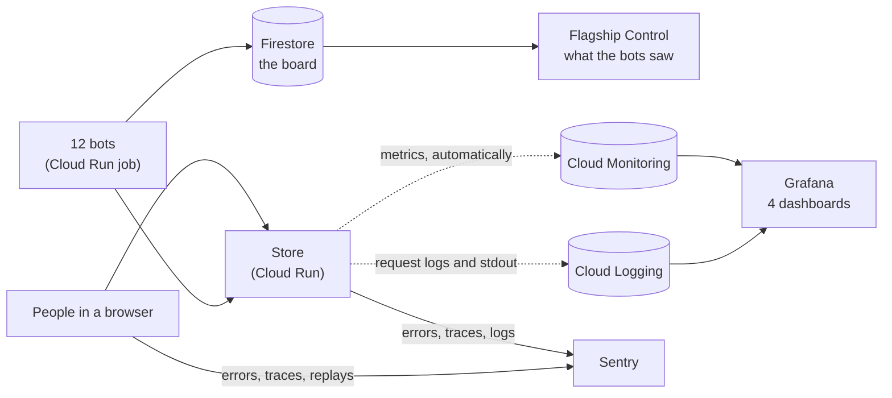
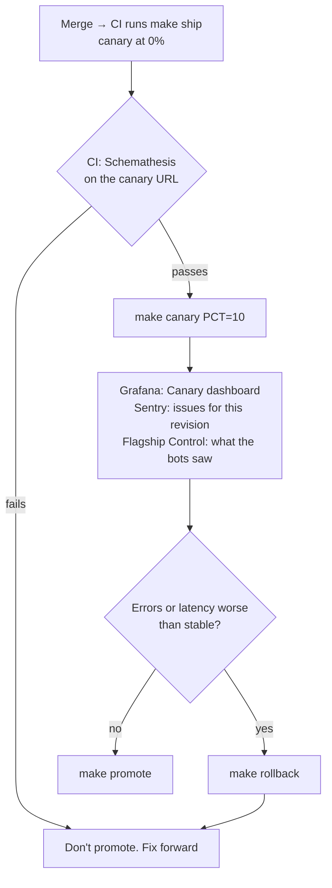

# Watching Flagship in production: an SRE starter

**SRE** (site reliability engineering) is Google's name for running software in production as an
engineering problem. The core of it fits in three sentences. Measure reliability the way users feel
it. Agree on how reliable is reliable enough. Spend the gap between the two on shipping changes, and
slow down when it runs out.

Flagship is small, but it has everything a real service needs to watch: traffic, deploys, canaries,
feature flags, things that break. This folder explains the tools that watch it.

| Doc | About |
| --- | --- |
| This page | What each tool is for, the words SRE people use, and what to watch during a canary or an incident |
| [grafana.md](grafana.md) | The four Grafana dashboards, PromQL, and dashboards as code |
| [sentry.md](sentry.md) | Errors, traces and replays, and the checkout drill |
| [../api.md](../api.md) | The OpenAPI contract and the checks that keep it honest |

## Which tool answers which question

| Question | Tool | Kind of monitoring |
| --- | --- | --- |
| Does the store look right to a user, right now? | The 12 bots and [Flagship Control](../../GUIDE.md#the-dashboard) | **Synthetic**: fake users on a schedule |
| Is each service healthy? How much traffic, how many errors, how slow, how full? | [Grafana](grafana.md), over Cloud Monitoring | **Metrics**: numbers over time |
| What exactly happened on that request? | Cloud Logging, in Grafana | **Logs**: one line per event |
| What broke, for whom, and on which line of code? | [Sentry](sentry.md) | **Errors, traces and replays** from real users |
| Does the API still keep its promises? | [The OpenAPI checks](../api.md) | **Contract tests**, in CI and on each canary |

No single tool is enough. In the [checkout drill](sentry.md#the-checkout-drill-a-bug-the-bots-cant-see),
the bots report a healthy store, because the page renders fine. Grafana shows a few 5xx on the
canary, but not why. Sentry shows the `KeyError`, the line, and that every failing visitor had the
orange button.

Cloud Run reports requests, latency, instances, CPU and memory for every revision without any
code in the app. That's why Grafana needed no changes to Rails. Sentry needs an SDK, because only
the app knows which line threw and who was asking.

## The words

| Word | Means | In this repo |
| --- | --- | --- |
| **The four golden signals** | Traffic, errors, latency, saturation. If you can watch only four things, watch these | Grafana's [Golden signals](grafana.md#golden-signals) dashboard |
| **p50, p95, p99** | Half, 95% and 99% of requests were faster than this. Averages hide the slow ones | Latency panels |
| **SLI** (indicator) | A number that says how users are doing | The share of store requests that don't fail with a 5xx |
| **SLO** (objective) | The target for the SLI | 99% over any 7 days |
| **Error budget** | The failures the SLO allows: 100% minus the SLO | 1% of requests. Canaries and drills spend it |
| **Burn rate** | How fast the budget goes. 1 spends it exactly over the SLO's window | The SRE workbook pages someone at 14.4, sustained for an hour |
| **Saturation** | How full the service is: instances, CPU, memory | The store is capped at 2 instances |
| **Cold start** | The wait while Cloud Run starts an instance from zero | About 9 s here. The price of scaling to zero |
| **Synthetic monitoring** | Scripted fake users checking the service | The bots |
| **RUM** (real user monitoring) | What actually happened to real users | Sentry's browser SDK and replays |
| **Sampling** | Keeping only some of the data to save money | Sentry traces 100% of people's requests, 10% of the bots' |
| **Mitigate, then fix** | Stop the bleeding first (rollback, kill switch), find the cause later | [GUIDE.md, section 8](../../GUIDE.md#8-when-it-breaks-rollback-or-kill-switch) |

## During a canary, watch this

1. **Before any traffic.** CI's last step checks the new canary against the OpenAPI spec. Red means
   don't go on.
2. **At 10%.** Open Grafana's [Canary dashboard](grafana.md#canary-old-vs-new). The new revision
   should get about a tenth of the requests, with errors and p95 latency no worse than stable's.
   Give it a few minutes: Cloud Run's numbers arrive about a minute late.
3. **In Sentry.** Search `revision:flagship-000NN-xyz` for the canary's revision. A new issue there is
   a reason to roll back even if the error rate looks small.
4. **Decide.** Same or better: `make promote`. Worse: `make rollback`, then fix forward.

## When something breaks

The same five steps whatever broke:

1. **Notice.** The bots show ✕, Sentry emails about a new issue, or the SLO dashboard's burn rate
   climbs.
2. **Find what changed.** Grafana's Canary dashboard says whether the errors come from one revision.
   Sentry's tags say whether they share a flag (`flag.orange_button: on`) or a cohort.
3. **Mitigate.** A bad revision: `make rollback`. A bad feature: `make flag-off FLAG=…`. Both take
   seconds, and neither needs the cause yet.
4. **Fix forward.** Find the cause with Sentry's stack trace and replay, fix it on a branch, merge,
   canary, promote.
5. **Look back.** How much error budget did it cost (SLO dashboard)? What would have caught it
   sooner? In the checkout drill, the answer is "the bots should click Buy now too".

## What it costs

Short answer: **about ¥0**, plus a few yen of image storage.

| Tool | Free allowance | This demo | Cost |
| --- | --- | --- | --- |
| Sentry (Developer plan) | 5,000 errors, 5M spans, 50 replays, 5 GB logs a month, 1 user | A few events per drill; replays only on errors | ¥0. When the quota runs out, Sentry drops events; the free plan never bills |
| Cloud Monitoring metrics | Google Cloud's own metrics are free | Everything Grafana shows | ¥0 |
| Cloud Monitoring reads | 1 million time series a month, per billing account | About 20 per dashboard refresh | ¥0 |
| Cloud Logging | 50 GiB a month per project; queries are free | A few MiB a month | ¥0 |
| Grafana on Cloud Run | Cloud Run's free tier (shared with the other services) | 2 GiB, billed only while it answers requests | ¥0 |
| Grafana's image in Artifact Registry | 0.5 GB for the whole registry | About 0.55 GB more, on top of the store images | About ¥10 a month |

Grafana's [Free tier watch](grafana.md#free-tier-watch) dashboard shows this month's usage against
these numbers. Prices from [Sentry's pricing page](https://sentry.io/pricing/) and
[Google Cloud Observability pricing](https://cloud.google.com/stackdriver/pricing), checked in
October 2026.

## Not here yet

- **Alerts.** Sentry emails new issues by default. A next step would be an alert on the SLO's burn
  rate, in Grafana or Cloud Monitoring, sent to Slack.
- **The bots clicking Buy now.** Then the checkout drill would show up on Flagship Control too.
- **Releases with commits in Sentry**, so an issue names the commit that introduced it.
- **On-call, runbooks and postmortems**: the human side of SRE.

## Further reading

- *Site Reliability Engineering* (Google), chapter 6, "Monitoring Distributed Systems": the four
  golden signals. Free at [sre.google/books](https://sre.google/books/).
- *The Site Reliability Workbook*, "Implementing SLOs" and "Alerting on SLOs": error budgets and
  burn rates, including where 14.4 comes from.
