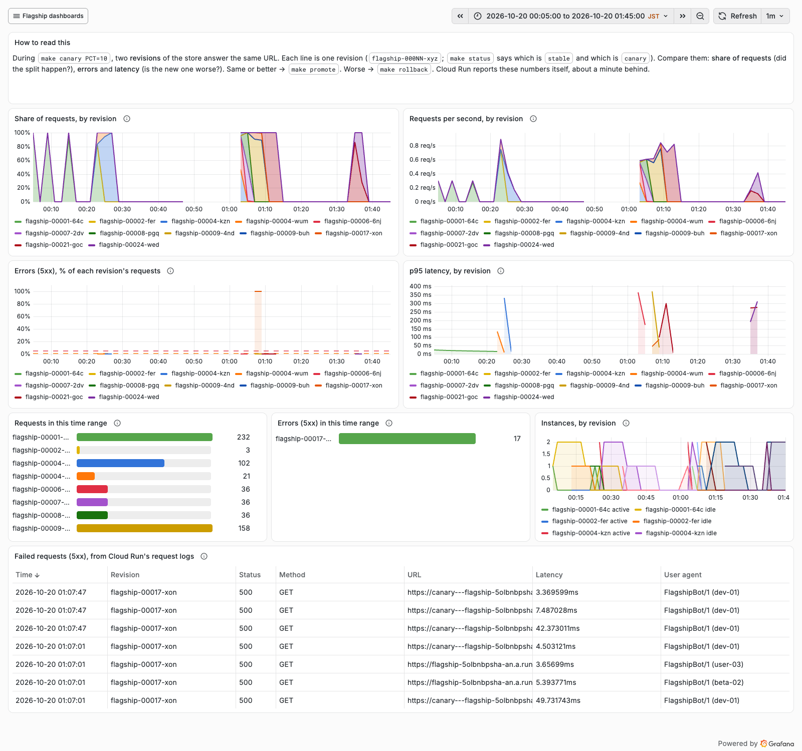
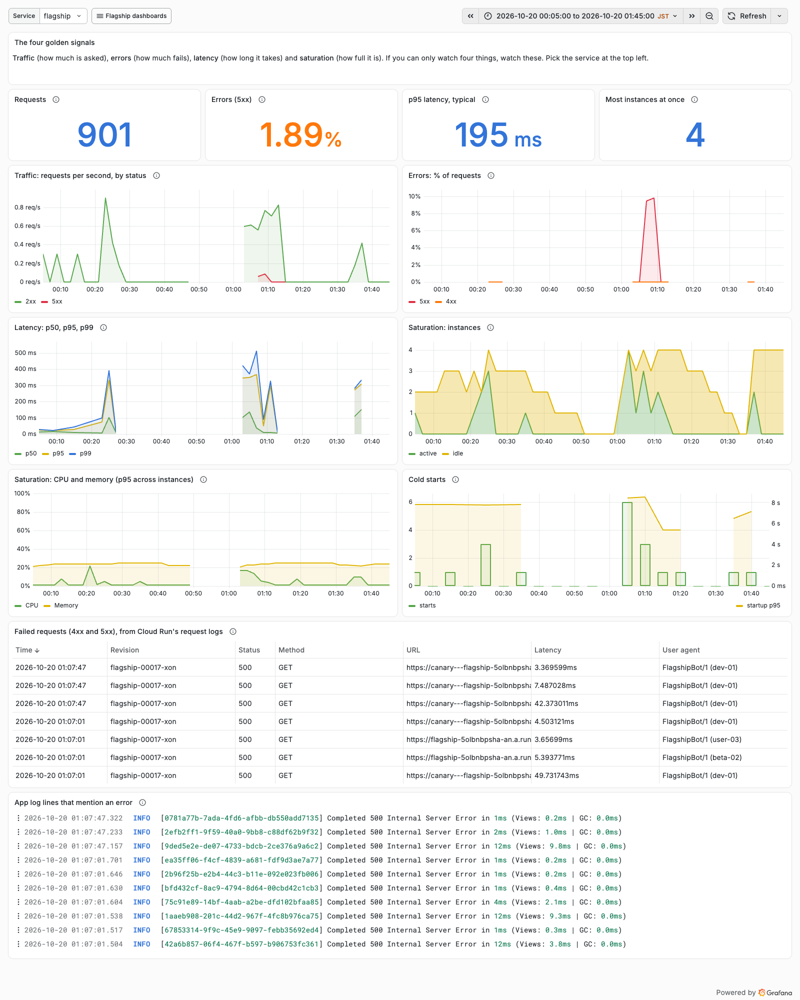
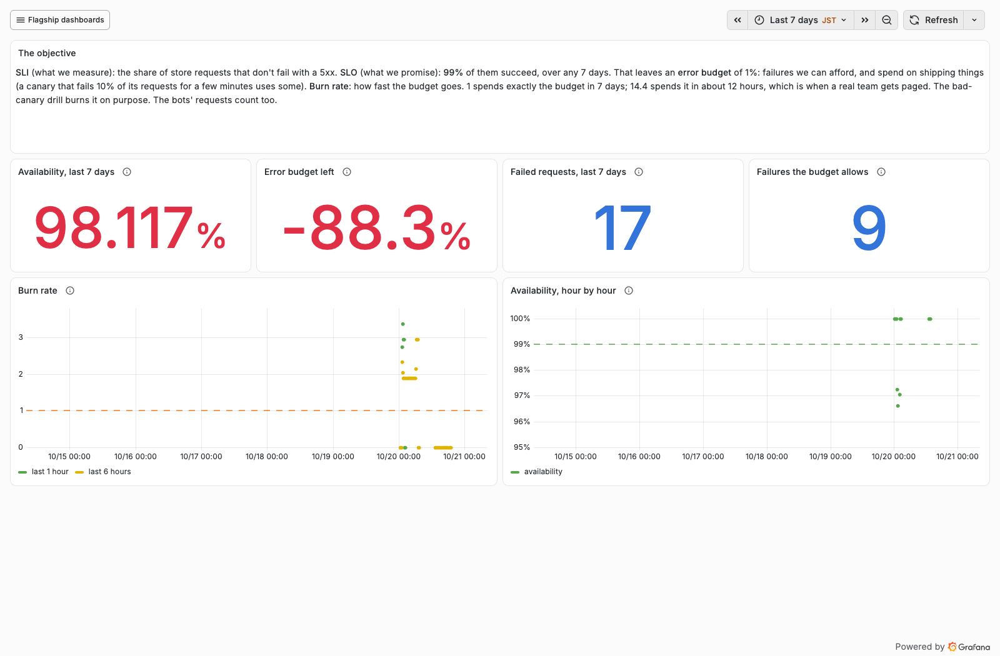
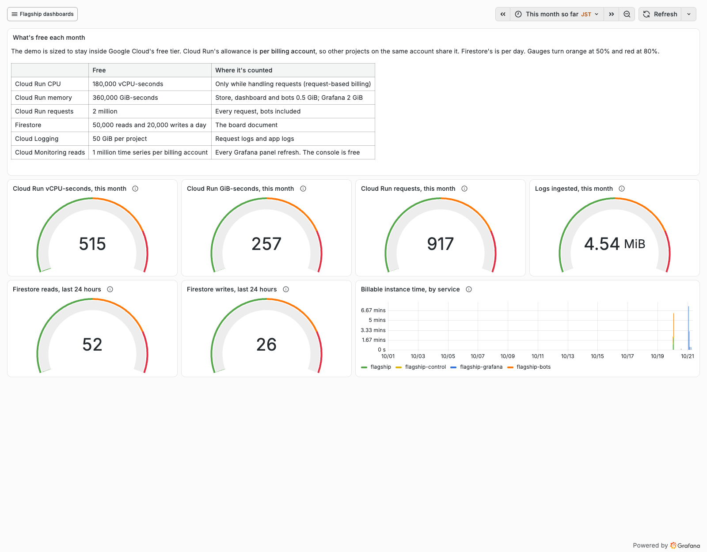

# Grafana: the dashboards

[Grafana](https://grafana.com/oss/grafana/) draws dashboards from other systems' data. Here it reads
**Cloud Monitoring**, where Cloud Run reports every revision's requests, latency, instances, CPU and
memory by itself, and **Cloud Logging**, where Cloud Run writes a log line for every request.
Nothing in the Rails app had to change.

- **URL:** https://flagship-grafana-5olbnbpsha-an.a.run.app (`make urls`)
- **Login:** user `flagship`, password from `make password`: the same login as Flagship Control.
- **Home:** the Canary dashboard. The others are in the **Flagship dashboards** menu at the top.

The first visit after a quiet spell takes about 20 seconds while Cloud Run starts Grafana. Grafana
keeps its logins in memory, so after a restart or a deploy it asks you to log in again.

## The four dashboards

### Canary: old vs new



During a canary, two revisions answer the store's URL. Each line is one revision, so you can compare
them directly.

- **Share of requests**: did the split happen? A 10% canary is a thin band on top.
- **Errors (5xx), % of each revision's requests**: a broken canary shows up here first. In the
  screenshot, `flagship-00017-xon` (the drill's broken canary, around 01:07) is at 100%: it failed
  every request it got.
- **p95 latency**: a canary that's slower than stable is worse, even with no errors.
- **Failed requests**: Cloud Run's request logs for every 5xx, with the revision that answered and the
  user agent. `FlagshipBot/1 (dev-01)` hit the canary tag URL directly; `user-03` and `beta-02` were
  the 10% the main URL sent there.

### Golden signals



The four golden signals for any service; pick it at the top left.

| Signal | Panels | In the screenshot |
| --- | --- | --- |
| **Traffic** | Requests, requests per second by status class | 901 requests over the drills |
| **Errors** | 5xx and 4xx as a share of requests | 1.89%, all from the broken canary |
| **Latency** | p50, p95, p99 | p95 around 195 ms; the spikes are cold starts |
| **Saturation** | Instances (active and idle), CPU, memory | Never more than 4 instances across all revisions; memory around 25% |

The **cold starts** panel shows the price of scaling to zero: about 9 seconds for the first request
after a quiet spell. With `--min-instances=1` it would be gone, and so would the free tier.

### SLO: store availability



An objective for the store: **99% of requests succeed over any 7 days** (see
[the words](README.md#the-words)). The drills broke it on purpose: 17 failed requests, when the
budget allowed 9, so the budget is at −88% and availability at 98.1%. The burn rate panel shows when
it happened. It will recover by itself as the drill slides out of the 7-day window.

A real team would now slow down: no risky releases until the budget is positive again. That's the
deal an SLO makes. Reliability work and feature work share one number.

### Free tier watch



This month's usage against Google Cloud's free tier: Cloud Run CPU and memory seconds, requests,
logs, and Firestore reads and writes. Gauges turn orange at 50% and red at 80% of the allowance.
The budget alerts email at ¥1,000 and ¥100; this dashboard shows how far away they are. So far
it's about 0.3% of the CPU allowance.

## Where the numbers come from: PromQL

The dashboards ask Cloud Monitoring in **PromQL**, the query language of
[Prometheus](https://prometheus.io/), the most common open-source monitoring system. Learn it here and
it works almost anywhere. Cloud Run's metrics have names like
`run_googleapis_com:request_count`, and labels like `service_name`, `revision_name` and
`response_code_class`.

```promql
# Requests per second for each revision of the store, averaged over the last 2 minutes
sum by (revision_name) (
  rate(run_googleapis_com:request_count{monitored_resource="cloud_run_revision", service_name="flagship"}[2m])
)
```

| Piece | Does |
| --- | --- |
| `metric{label="value"}` | Picks the series: here, the store's request counts |
| `rate(…[2m])` | Per-second rate over the last 2 minutes. Counters only go up; rate turns them into speed |
| `increase(…[2m])` | How much it went up in those 2 minutes |
| `sum by (revision_name) (…)` | Adds up all series with the same revision: one line per revision |
| `histogram_quantile(0.95, sum by (le) (rate(…_bucket[2m])))` | p95 from a latency histogram (`le` is each bucket's upper bound) |
| `… or vector(0)` | "0 if there's nothing". No 5xx means no 5xx series at all, and a ratio of nothing is nothing |

To try queries, open **Explore** (the compass icon), pick *Google Cloud Monitoring*, switch the
query type to **PromQL**, and paste one. *Google Cloud Logging* in Explore takes the same filters
as the Cloud Console's Logs Explorer, for example `resource.labels.service_name="flagship" httpRequest.status>=500`.

## Dashboards as code

The dashboards are JSON files in git, like the rest of the app:

```text
grafana/
├── Dockerfile               Grafana 13, plus the Cloud Logging plugin, plus the files below
├── grafana.ini              settings: login, no sign-ups, no phoning home
├── start.sh                 fills the project ID into the dashboards, then starts Grafana
├── provisioning/
│   ├── datasources/         Cloud Monitoring and Cloud Logging, signed in as flagship-grafana
│   └── dashboards/          "load every JSON file in /tmp/dashboards"
└── dashboards/              canary.json, golden-signals.json, slo.json, free-tier.json
```

Grafana keeps no state. Every start loads the same dashboards from these files, so nothing lives
only in a database, and a deploy can't lose a dashboard someone edited by hand.

**To change a dashboard:**

1. In Grafana, open it, then **Edit** → **Save as** to make a copy you're allowed to change. The
   provisioned ones are read-only on purpose.
2. Change the copy until you like it.
3. **Export** → **Export as JSON**, and paste it over the file in `grafana/dashboards/`. Keep the
   original `uid` and `title`.
4. Open a PR. When it's merged, CI runs `make grafana`, which rebuilds Grafana only when the
   `grafana/` folder changed.

`make grafana` names the image after the git tree of `grafana/`, so the same dashboards always make
the same image, and an unchanged folder is a no-op.

**Access without keys.** Grafana runs as its own service account, `flagship-grafana`, which can
only read metrics and logs (`roles/monitoring.viewer`, `roles/logging.viewer`). The data sources use
"GCE" authentication: Grafana asks Cloud Run's metadata server for a short-lived token, the way any
app on Cloud Run does. There's no JSON key file to leak.

## Gotchas found while building this

| What happened | Why | What the repo does |
| --- | --- | --- |
| PromQL panels crashed the Cloud Monitoring plugin (`nil pointer dereference`) | Plugin v12.6.2 treats a query with no `timeSeriesList` as an old format and rewrites it, losing the PromQL | Every target carries an empty `timeSeriesList`, as the query editor's do |
| Panels said "No data" in the browser, though the API returned data | The plugin's frontend skips a PromQL query with no project | `start.sh` fills in the project ID on start |
| "Total in this time range" panels failed: `unexpected character in duration expression: '$'` | The plugin fills in `$__interval` but not `$__range` | Totals add up `increase(…[$__interval])`. Step and window are the same, so nothing is counted twice |
| Grafana kept restarting, and logged everyone out | Grafana 13 idles at about 850 MiB; at 1 GiB, Cloud Run killed it 12 times in 2 hours | 2 GiB. Billed only while it answers requests |
| A short burst of traffic was invisible on a 7-day graph | A line needs at least two points next to each other | Panels show points when the data is sparse |

## Costs

All within the free tier, except storage for Grafana's image (about 0.55 GB, roughly ¥10 a
month). See [the cost table](README.md#what-it-costs). Each panel refresh reads a few time series
from Cloud Monitoring; the first million a month are free, and only the Canary dashboard refreshes
by itself (every minute, while it's open).
