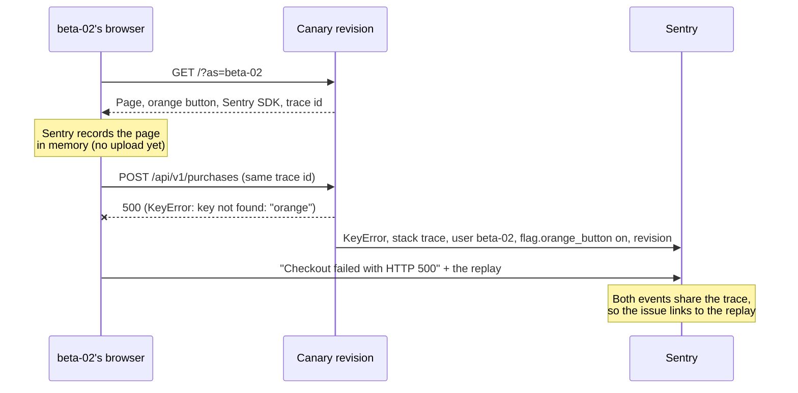

# Sentry: errors, traces and replays

[Sentry](https://sentry.io) answers "what broke, for whom, and why". When code throws, the SDK
sends the exception to Sentry with everything around it: the stack trace with the source lines,
the request, the visitor, their flags, the revision and the build. Sentry groups identical errors
into one **issue**, so a bug that hits 500 visitors is one line with a count, not 500 emails.

The project is [`flagship`](https://cargill-seiveright.sentry.io/projects/flagship/) in the
`cargill-seiveright` organization. One project holds both the Rails and the browser events.

## What gets sent

| Signal | From | What you see in Sentry |
| --- | --- | --- |
| Server errors | Store, dashboard and bots job (`sentry-rails`) | Stack trace with code, request, breadcrumbs, user, tags |
| Browser errors | The store page (Sentry's browser SDK, from its CDN) | The JavaScript error, the page, the browser |
| Traces | Both | One trace from the click in the browser, through the API call, to the controller |
| Session replays | The store page, **only when an error happens** | A video-like replay of the minute before the error |
| Logs | Rails | Each request's controller, status and duration, next to its trace |

Nothing is sent unless `SENTRY_DSN` is set. Tests and laptops stay quiet.

### What every event carries

[`SentryVisitorContext`](../../app/controllers/concerns/sentry_visitor_context.rb) runs at the
start of each store and API request and tells Sentry who's asking:

| Field | Example | Why |
| --- | --- | --- |
| user | `beta-02`, segment `beta` | How many visitors an issue hurts, and which ones |
| tag `cohort` | `beta` | "Only beta testers see this" |
| tag `flag.orange_button` | `on` | "Every event has the flag on": a job for the kill switch |
| context `feature_flags` | `{ enabled: true, reason: "segment beta" }` | Which targeting rule switched it on |
| tag `revision` | `flagship-00025-abc` | Canary or stable? |
| release | `flagship@be0f7a3` | Which commit. Sentry marks issues that are new in a release |
| tag `service` | `flagship`, `flagship-control`, `flagship-bots` | Which Cloud Run service or job |

Tags are indexed, so the issue page shows their spread ("flag.orange_button: on 100%") and you can
search by them: `flag.orange_button:on revision:flagship-00025-abc`.

## Turning it on

```sh
make sentry DSN=https://…@o….ingest.us.sentry.io/…   # once; the DSN is under Settings > Projects > flagship > Client Keys
```

That stores the DSN in Secret Manager and hands it to the store, the dashboard and the bots. Like
a flag change, it makes a new revision of each, so run it while traffic follows the latest revision
(not in the middle of a canary). Later deploys keep it.

On your laptop: `SENTRY_DSN=https://… make dev`. Events arrive with `environment: development`.

## The checkout drill: a bug the bots can't see

The page drill (`make ship-broken`) breaks every page, and the bots notice at once. This one is
sneakier, and closer to real life: a bad commit breaks **Buy now**, and only for visitors who have
the orange button. The page still loads and the button is still orange, so every bot reports a
healthy store.

```sh
make flag FLAG=orange_button SEGMENTS=beta   # beta testers get the orange button
make ship-broken BUG=checkout                # a canary whose checkout forgets the orange price
# open the canary URL it prints with ?as=beta-02, and click Buy now
```



What Sentry shows (from a run on a laptop; the issue is
[FLAGSHIP-1](https://cargill-seiveright.sentry.io/issues/FLAGSHIP-1)):

- **KeyError: key not found: "orange"** in `Api::V1::PurchasesController#create`, with the culprit
  line: `prices.fetch(color)` in `price_for`, `purchases_controller.rb:34`.
- **user** `beta-02`, **cohort** `beta`, **flag.orange_button** `on`, **release** and **revision**.
- **feature_flags** context: `orange_button: { enabled: true, reason: "segment beta" }`.
- A **replay** of beta-02's session: the page loading, the click, the error message appearing.
- The **trace**: the browser click, the POST, the controller, the exception.

Then decide, the way you would in a real incident:

| You see | It means | Do |
| --- | --- | --- |
| Every event is on the canary revision | The new code is the problem | `make rollback`, then fix forward |
| Every event has `flag.orange_button: on` | The new feature is the problem | `make flag-off FLAG=orange_button`: no deploy, seconds |
| Both | Either works. The flag is faster and keeps the rest of the release | Flag off now, fix later |

Why didn't the bots catch it? They're **synthetic monitoring**: they check that pages render.
Sentry is **real user monitoring**: it sees what actually happened to the people using the app.
You want both. See [the monitoring overview](README.md).

## Sampling and quotas

The free Developer plan includes 5,000 errors, 5 million spans, 50 replays and 5 GB of logs a
month. When it runs out, Sentry drops the extra events; the free plan never bills you.

| Setting | Where | Value | Why |
| --- | --- | --- | --- |
| Traces from people | `config/initializers/sentry.rb` | 100% | Low traffic, and you want to see every one |
| Traces from bots and Schemathesis | same | 10% | They make hundreds of requests a run |
| Replays of normal sessions | `app/views/layouts/_sentry.html.erb` | 0% | 50 a month goes fast |
| Replays of sessions with an error | same | 100% | That's when you want one |

## Privacy choices

- sentry-ruby 7 collects little by default: no IP addresses, cookies, request bodies or query
  strings, and headers that look personal (like `X-Demo-User`) arrive as `[Filtered]`. The app
  sends the visitor's handle on purpose, as `user.id`. In a real app, send an internal user ID,
  not an email.
- The browser SDK (v11) is the opposite: by default it sends the visitor's IP address and cookies.
  The store turns both off (`dataCollection: { userInfo: false, cookies: false }` in
  `_sentry.html.erb`). The first test events, before that line existed, have an IP address.
- Replays **keep the page text** (`maskAllText: false`) because the store shows nothing personal.
  Real apps keep Sentry's default, which masks all text and inputs.
- Sentry guesses a rough location from the IP address (`user.geo`) without storing the IP. To stop
  that: Settings > Projects > flagship > Security & Privacy > Prevent Storing of IP Addresses.

## Going further

- **Releases with commits**: create the release in CI with its commits, so Sentry names the commit
  that introduced an issue (Claude Code's `sentry-setup-releases` skill can set this up).
- **Alerts**: an email or Slack message when an issue is new, or when errors spike on a canary.
- **Seer**: Sentry's AI agent can explain an issue's root cause from the stack trace and trace.
